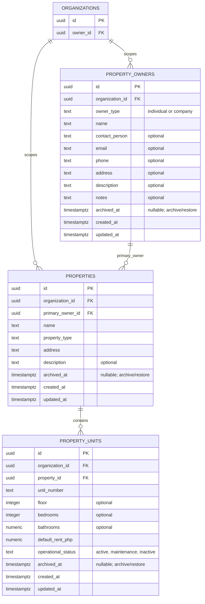
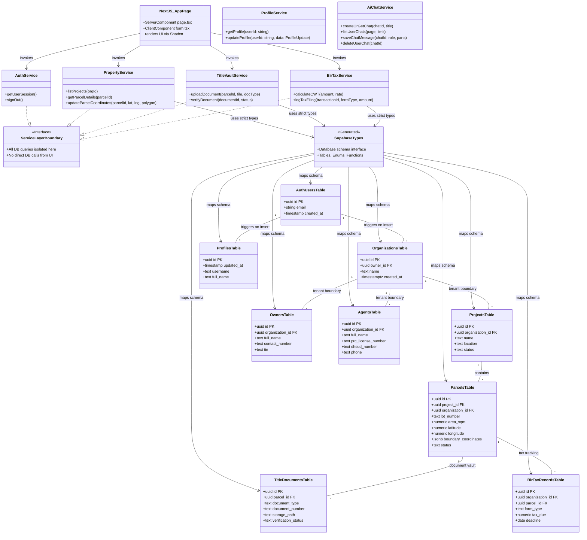

# 🏗️ Domain & Service Architecture Diagram

This diagram maps the structural relationships between Next.js UI Components, the **Service Layer** (`src/services/`), TypeScript Definitions (`src/types/`), and Supabase Backend Entities.

---

## Mermaid Domain Architecture Diagram

> The legacy class diagram below includes template-era sample entities. For the current JuanProperty Phase 1 implementation, the authoritative domain slice is Organization → Property Owner → Property; later entities remain planned.

`properties` carries `organization_id` and `primary_owner_id`; a composite foreign key requires the selected Property Owner to belong to the same organization. `property_units` carries its organization and property IDs with a composite foreign key to ensure the same boundary, and a case-insensitive unique index protects unit identity within a property. All three tables use organization-owner RLS and authenticated SELECT/INSERT/UPDATE privileges only; `anon` has no table access, and authenticated users have no DELETE or TRUNCATE privilege. Services derive the organization from the authenticated session rather than accepting an organization identifier from the UI. Units have operational state and default rent only; future Lease records determine occupancy and preserve agreed rental amounts.

---

## Architectural Guidelines

1. **UI Layer Isolation**: Next.js pages and Shadcn components inside `src/app/` and `src/components/` must **never** call `supabase.from(...)` directly.
2. **Service Layer Responsibility**: All CRUD operations, tenant isolation checks, and business rules belong exclusively in `src/services/`.
3. **Type Contracts**: Functions in `src/services/` import data types strictly from `src/types/supabase.ts` (auto-generated via `npm run db:types`).
